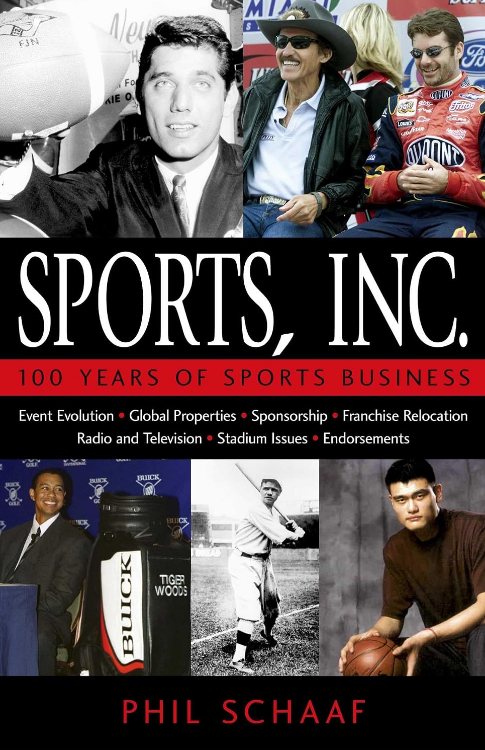
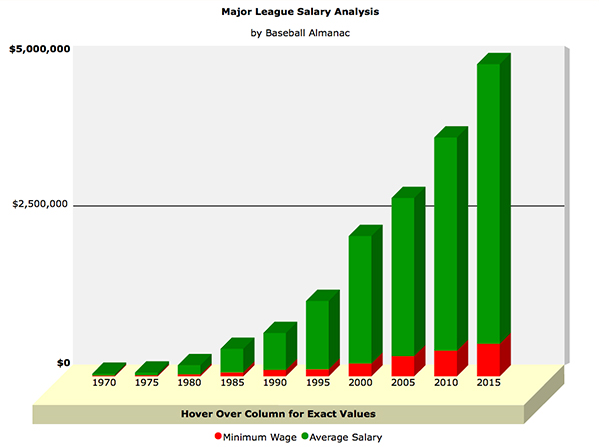
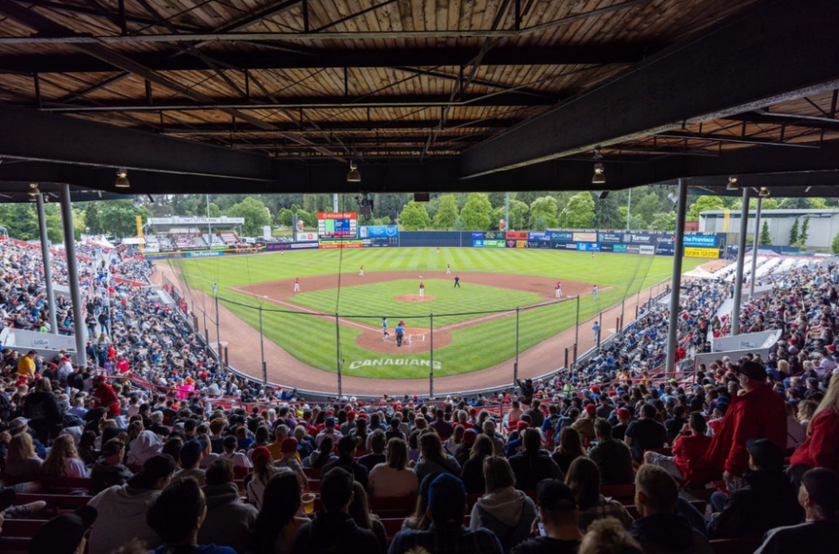

## Sports Inc.

Let's talk about the business of sports in the 20th century for a moment, as described in the book Sports, Inc. - 100 Years of Sports Business, by Phil Schaaf.  (available though Waterloo Public Library, John Harper branch)

{width=40%}

## Sports Inc.

Over the last 125 years, the size of the economy has grown at an exponential rate, with some notable interruptions. The size of the sports economy has grown exponentially too, but at a much faster rate.

## Sports Inc.

MLB salaries and team valuations are a good indicator of this growth, at least since 1967 when television really took things into the stratosphere.

In 1966, the MLB Players Association was founded. In 1967, the minimum wage for a MLB player was \$6,000. (\$60,528 in 2026 money, according to https://www.calculator.net/inflation-calculator.html )

- In 1976, it was $19,000
- In 1986, it was $60,000
- In 1996, it was $109,000
- In 2006, it was $327,000
- In 2016, it was $507,500
- In 2026, it was $780,000

Source: https://www.baseball-almanac.com/charts/salary/major_league_salaries.shtml 

{width=40%}

## Sports Inc.

While minimum salaries saw their fastest growth right after unionization, the valuation of teams  has been explosive more recently. Forbes lists the valuation of the Yankees at 8500 million USD now, and 362 million USD in 1998.

https://www.forbes.com/teams/new-york-yankees/

https://www.sportsbusinessjournal.com/Daily/Issues/2001/07/26/Ratings-Research/FORBES-MLB-VALUATIONS/ 

That is to say, it's easy to see these teams as cultural institutions, but they're also business entities.

## As above, so below

Sports is a business, and like any other business over the last few decades, there has been a tendency towards mergers and acquisitions. However, since sports is also a business predicated on competition, those mergers look a little different than they would in other business contexts - they sometimes form multi-team, multi-sport organizations.

## As above, so below

In 2008, there were 1,484 companies listed on the TSX, not including the venture exchange, not including ETPs (Exchange traded products and funds, which are not companies).
In 2012, there were 1,187
In 2017, there were 974
In 2022, there were 860
In 2026, there are still 860

https://www.tsx.com/en/listings/current-market-statistics/mig-archives

Companies of every kind are merging into larger and larger conglomerates, and the sporting world is no different. There are many sports brands, but relatively few sports companies.

## As above, so below

Why should you care? Because a lot of you are considering working in the sports industry as an option, and it helps to know what the common corporate structures look like. This is ESPECIALLY true in sports analytics, because a lot of the skills (programming, math, visualization, and writing) transfer quickly from one sport to another, so you could conceivably be a multi-sport analyst for one of these organizations.

## Farm Team Systems

How is this different then a minor league affiliate (farm team) system?

A farm team system is a sports organization composed of teams of the same sport in leagues at different levels. The teams at the lower levels exist to develop/keep active/rehabilitate players for the top level. The lower level teams may make a profit, but their main purpose is to feed the upper level teams while breaking even or losing money slowly. This also means that players on these farm teams make some pretty poor wages.

## Farm Team Systems

Specifically the major league teams own the minor league affiliate. Draftees of the major league teams usually start by playing on one of the affiliate teams until they are ready for the majors.    This ownership model is one reason why relegation and promotion of teams between leagues can't work, because it would open the possibility of a team needing to play against its own farm.

In the Blue Jays' case, they also used their minor league affiliates ballparks to play during the pandemic. 

## Farm Team Systems

This is Nat Bailey Stadium, where the Vancouver Canadians play. Note that the only other nearby source of pro baseball is Seattle.  Photo source:

https://www.vancouverisawesome.com/sponsored/heres-why-the-vancouver-canadians-are-still-the-most-fun-and-affordable-ticket-in-town-8718502

{width=70%}

## Farm Team Systems

The Toronto Blue Jays have seven minor league affiliate teams as of 2026:

- The AAA level Buffalo Bisons.
- The AA level New Hampshire Fisher Cats
- The high-A level Vancouver Canadians (which frequently sells out, see photo)
- The single-A level Dunedin Blue Jays
- 3 Rookie level teams: the FCL (Florida Complex League) Blue Jays, DSL (Dominican Summer League) Blue Jays Red and Blue Jays Blue.

## Farm Team Systems

We're talking about organizations that own two or more teams AT THE PEAK LEVEL, often alongside other properties that integrate well with sports, like stadiums, training facilities, and media properties like television stations.

We're going to focus on three such multi-team organizations, Maple Leaf Sports and Entertainment (MLSE), the Fenway Sports Group (FSG), and Red Bull (RB).

## Maple Leaf Sports and Entertainment 

(now owned by Rogers Communications)

- Toronto Maple Leafs, Toronto Marlies
- Toronto Raptors
- Scotiabank Arena (venue for the Maple Leafs and the Raptors)
- Toronto Argonauts
- Toronto FC
- Toronto Tempo
- Toronto Blue Jays (parent company)
- Raptors Uprising (eSports)

Rogers to Become 100% Owner of Maple Leaf Sports & Entertainment
July 6, 2026

https://about.rogers.com/news/rogers-to-become-100-owner-of-maple-leaf-sports-entertainment/

## Maple Leaf Sports and Entertainment 

When I first tried to write this, I thought I would start with the history of teams that MLSE has bought and sold. It turns out that alone is too much for a talk. Let's go to the Wikipedia page for MLSE to get a sense of this. In particular, I want to read out the time that the Hamilton Tiger Cats were sold for a toonie.

https://en.wikipedia.org/wiki/Maple_Leaf_Sports_%26_Entertainment

## Fenway Sports Group

- Fenway Park
- Boston Red Sox (Baseball, MLB team)
- Pittsburgh Penguins (Hockey, NHL team)
- Liverpool Football Club (Soccer, English system team)
- PGA Tour (Golf league, large partial stake)
- Boston Common Golf (TMRW Golf league team, indoor golf)
- North England Sports Network (TV network for sports around Boston)
- Fenway Sports Management (marketing arm)
- FSG Real Estate (Stadiums, training facilities)

https://fenwaysportsgroup.com/

## Fenway finally gets Billy Beane.

In 2002, Billy Beane, then general manager and later executive vice president of the Athletics, then of Oakland, was offered $12.5 million USD to become the general manager of the Red Sox, then of Boston. He declined. 

However, in 2020, FSG acquired Redball Acquisition Corp., of which Beane was a co-chair, which gave him a financial interest in both the Athletics and Red Sox, which are two teams in the same league, meaning that he had to leave any decision-making position in baseball to avoid a conflict of interest.

Moneyball, Michael Lewis, page 62.

https://www.nytimes.com/2002/11/11/sports/baseball-beane-wavers-then-says-no-to-red-sox.html

https://www.nytimes.com/athletic/4233897/2020/10/12/longtime-as-exec-billy-beane-set-to-join-fenway-sports-group-report/

## Local domination

MLSE, FSG (and several of the other honourable mentions, like Monumental and Kroenke) own the lion's share of physical sports in their home locations of Toronto / South Ontario and Boston / New England, respectively.  This means they have a (nearly) captive audience no matter how well or poorly any individual team or league is doing.

## Local domination

It also means that the revenue stream is steadier because there's never an 'off season' where none of the holdings are playing.

For example, are the Blue Jays not living up to their 2025 season expectations? Some of those fans that have tuned out will watch Toronto FC instead. Others will do something else for their summer hours, but might watch more Toronto Maple Leafs or Toronto Raptors in the winter to compensate. 

## Red Bull

- New York Red Bulls, RB Leipzig, Red Bull Bragantino, RB Omiya Ardija etc. (Soccer, leagues globally)
- Newcastle Red Bulls (Rugby team)
- Red Bull Racing, Red Bull Powertrains (Formula racing, as both a car constructor and an engine manufacturer)
- EC Red Bull Salzburg (Hockey team)
- Red Bull Media House, Red Bull TV, Red Bull Studios (Media production focused mostly on RB's sports holdings)
- Flugtag, Crashed Ice, Cliff Diving, Stratos (Recurring and one-time events)
Extensive eSports sponsorships.

## Integration

I've recommended this video titled "How Does Red Bull Make Money" by "Athletic Interest" over a dozen times, and it's still relevant, albeit outdated. One thing to note is that the eSports stars will train in the same places as the soccer stars, which is seen as a perk by both groups. 

https://www.youtube.com/watch?v=cBRNQMolTPw 

## Integration

Red Bull owns soccer teams around the world at different levels. "A player could develop in Brazil at Bragantino, be transferred to Leipzig at their prime, and then play their older years for New York." - Athletic Interest. 

## Integration

This allows the organization to consider player development and wellbeing on a longer timeline than a single-team organization has the luxury of doing. Some single-sport North American organizations, especially in baseball and hockey, have a farm team system that operates similarly, but not in soccer which is famously/notoriously very multi-league.

## Integration

Red Bull produces their own media in house, which allows for greater logistic control, as well as cost savings from shared resources, and also smooths out the seasonality of workloads because of the variety of sports.

Red Bull is originally an energy drink company that did extreme sporting events as advertising stunts. Now it is a profitable sports company that is its own main advertising partner.

MLSE and FSN own many of the buildings that house the fans during events, and the buildings that house players during training.

There are many others worth mentioning, which we won't examine further:

## Other MTOs

Monumental Sports and Entertainment

- Washington Capitals (hockey team)
- Washington Wizards (NBA basketball team)
- Washington Mystics (WNBA basketball team)
- Team Liquid (eSports, itself multiple teams)

## Other MTOs

Kroenke Sports and Entertainment

- Los Angeles Rams (NFL football team)
- Denver Nuggets (NBA basketball team)
- Colorado Avalanche (NHL hockey team) 
- Colorado Rapids (MLS soccer team) 
- Colorado Mammoth (NLL lacrosse team) 
- Arsenal FC (Soccer English system)
- SoFi Stadium and Hollywood Park, Ball Arena, Dick's Sporting Goods Park, 
- sports broadcasting, and other entertainment properties.

## Other MTOs

Harris Blitzer Sports & Entertainment (HBSE)

- Philly 76ers (NBA basketball team)
- New Jersey Devils (NHL hockey team)
- Crystal Palace FC (Soccer, English system, partial stake)
- Various minor league teams
- Prudential Center
- Dignitas esports 

## Other MTOs

Madison Square Garden Sports Corp.
- New York Knicks (NBA basketball team) and their farm teams
- New York Rangers (NHL hockey team) and their farm teams
- ...but not Madison Square Garden itself.

## Other MTOs

TKO Group Holdings
- UFC (Fighting)
- WWE ("Fighting")
- PBR (Professional bull riding league)
- Zuffa Boxing

City Football Group
- 12 soccer teams globally

Miller Sports and Entertainment
- 3 soccer teams in Utah

## Other MTOs

...because I'm getting tired of listing these, but consider all of these your resume go-to list

Qatar Sports Investments (international)
49ers Enterprises (international)
The Friedkin Group (international)
Black Knight Football Club (international, soccer)
Comcast Spectactor (eSports)
OverActive Media (eSports, Canada)

## The boundary between gambling and sports.

For now, there seems to be a separation between the owners of teams and the owners of major gaming or gambling assets. MLSE, FSG, RB, and MSE all avoid having any assets where fans can place a wager against the house or each other. That means none of these team-owning organizations own a sportsbook or fantasy sports site like betMGM or FanDuel respectively, or a poker website, or even any horse racing assets. However, there's a lot of gambling information still available through the media arms of these companies, like NESN and Rogers (MLSE's owner) providing odds on players winning.

## The boundary between gambling and sports.

Also, sports organizations that do NOT own teams don't seem to have that separation. PENN Entertainment, which owns Toronto-based sports betting and information platform theScore, does a lot of sports media work. MGM Resorts owns both physical casinos in Las Vegas and the betMGM online platform - they also own the arena that the Las Vegas Golden Knights (NHL) plays.

## The boundary between gambling and sports.

The reason for this split is mostly due to regulations within the leagues themselves, rather than legal requirements by the governments of North America and Europe as a whole. My hunch is that sports leagues know their business relies on the perceived integrity of the events they sell, and holding 'owners as bettors' as a hard red line.  

(If anyone is interested in the legal or social issues of this, it would make a great case study, because from my limited look, it's a really complex mess). 

## The boundary between gambling and sports.

See also insuring against performance-based promotions like the free windows that everyone in Cleveland got when the Guardians got their 15th win in a row in 2017.

Insurance is the financial equivalent of gambling, except the jackpot only pays off to offset something bad happening.

Also, this was a local shop making the bet, not the team owners, but it's still worth thinking about.
 https://www.mlb.com/cut4/local-cleveland-shop-celebrates-indians-winning-streak-with-large-home-repair-pr 

## Conflicts of interest.

How do these mutli-team, multi-sport organizations avoid conflicts of interest? The simplest way is to never own more than one property that's in direct sporting competition with another. That's relatively easy in sports without promotion or relegation, but harder in soccer. 

## Conflicts of interest.

Less directly, teams that play at the same time of year are competing with each other for venue space and for fan attention. This can be mitigated with careful scheduling, especially in cases like the Raptors and the Maple Leafs both play in Scotiabank Arena and need to change the floor every time there's a change, despite both teams being most active in winter.

## Conflicts of interest.

Occasionally Red Bull teams play against each other in soccer, but only in friendlies - there are no RB teams that are in the same stack of leagues as each other. In Formula 1 it's a lot more complicated because Red Bull Racing and Racing Bulls are two distinct racing teams. This is in an ongoing controversy.

## Finally, next term?

- Analysis of 'high variability' outcome stats, like number of home runs.

- Local LLM app that takes player boxscores and play-by-play data and writes a summary.