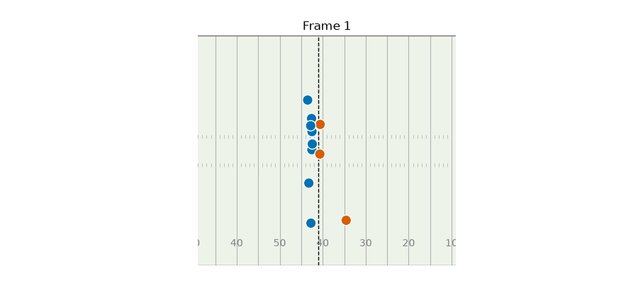

```{r setup}
#| include: false
#| purl: false
# use the first Python that has the packages this deck needs
candidates <- unique(Filter(nzchar, c(Sys.getenv("RETICULATE_PYTHON"),
                                      Sys.which(c("python3", "python")),
                                      "/usr/local/bin/python3", "/usr/bin/python3")))
has_pkgs <- function(py) {
  file.exists(py) && identical(0L, suppressWarnings(system2(
    py, c("-c", shQuote("import pandas, matplotlib, pyarrow, PIL")),
    stdout = FALSE, stderr = FALSE)))
}
python <- Find(has_pkgs, candidates)
if (is.null(python)) stop("No Python with pandas, matplotlib, pyarrow and pillow found")
reticulate::use_python(python, required = TRUE)
```

## Today

1. What the 2027 Big Data Bowl is asking
2. The data: 7 files joined by one key, `nfl_id`
3. **Clean:** rebuilding the [ngscleanR](https://github.com/guga31bb/ngscleanR) helpers for the 2027 data
4. **Visualize:** plays, routes and Combine drills
5. A first **Combine → NFL** link
6. Brainstorming and resources

Every code slide has **R** (tidyverse) and **Python** (pandas + matplotlib) tabs. The same code is in `bdb_tutorial.R` and `bdb_tutorial.py`.

::: {.small .muted}
Builds on Ron Yurko's [CMSAC 2022 Big Data Bowl workshop](https://www.stat.cmu.edu/cmsac/conference/2022/workshop/slides.html) and Ben Baldwin's [ngscleanR](https://github.com/guga31bb/ngscleanR).
:::

## What is the Big Data Bowl?

- An annual NFL analytics competition on [Kaggle](https://www.kaggle.com/competitions/nfl-big-data-bowl-2027), built on Next Gen Stats player tracking
- **2027 theme: Combine → NFL performance.** Find *non-obvious, actionable* links between 10 Hz **Combine drill tracking** and **regular-season** game performance.
- Two tracks: **Open** and **University** (undergraduates only)
- Submission: a Kaggle Writeup of **≤ 2,000 words** with **< 10 figures/tables**, plus a public notebook
- Judging: Football 30% · Data Science 30% · Writeup 20% · Data Visualization 20%
- Entries **must use the tracking data**. Official 40 times alone don't count.
- **Due Jan 6, 2027** (11:59 PM UTC). Finalists present at the 2027 Scouting Combine.

## The data

510 rookies drafted or signed in 2023–2025, tracked at the Combine **and** in NFL games from 2023 to 2025.

| File | One row per | Keys | Rows |
|---|---|---|---|
| `players.csv` | player | `nfl_id` | 510 |
| `combine_results.csv` | player | `nfl_id` | 510 |
| `combine_tracking.csv` | drill attempt × frame (10 Hz) | `nfl_id`, `event_id`, `attempt` | 463k |
| `player_career_successes.csv` | player | `nfl_id` | 510 |
| `games.csv` | game | `game_id` | 1,002 |
| `player_play.csv` | player × play | `game_id`, `play_id`, `nfl_id` | 316k |
| `game_tracking_{2023,2024,2025}.csv` | player × play × frame (10 Hz) | `game_id`, `play_id`, `nfl_id`, `time` | 22.6M |

## How the files join

```{mermaid}
%%| echo: false
flowchart LR
  CT["combine_tracking<br/>drill x frame"] -->|nfl_id| P["players<br/>combine_results<br/>career_successes"]
  P -->|nfl_id| PP["player_play<br/>player x play"]
  G["games<br/>season_type"] -->|game_id| PP
  PP -->|game_id, play_id, nfl_id| GT["game_tracking<br/>player x play x frame"]
```

`nfl_id` is the bridge: **Combine** on the left, **Sundays** on the right.

## How 2027 differs from past BDBs

::: {.callout-warning appearance="simple"}
- **Only the 510 rookies are tracked in games.** Most plays have 1–2 tracked players (at most 11), and there's **no ball**.
- Game tracking has **no `frame_id`, team or jersey**. Build the frame from `time` and join `player_play` for everything else.
- `play_direction`, line of scrimmage, `route_ran`, coverage and separation all live in **`player_play.csv`**.
- `games.csv` mixes PRE / REG / POST. The prompt is about the **regular season**, so drop plays with `play_nullified_by_penalty == "Y"` as well.
- Combine tracking: **drill names drift** across years, coordinates are drill-local, `dis` under-counts, and clips begin in motion.
- License is CC BY-NC, so **keep the raw data out of public GitHub repos**.
:::

# Part 1 · Load {background-color="#f6e7a8"}

## Packages

::: {.panel-tabset group="language"}
### R

```{r}
library(tidyverse)   # readr, dplyr, tidyr, ggplot2, purrr
library(arrow)       # Parquet + lazy, out-of-memory queries
library(gganimate)   # animations (renders GIFs with gifski)
library(patchwork)   # put ggplots side by side

theme_set(theme_minimal(base_size = 14))
side_cols <- c(Offense = "#0072B2", Defense = "#D55E00")   # Okabe-Ito
```

### Python

```{python}
import os
import numpy as np
import pandas as pd
import matplotlib.pyplot as plt
import pyarrow as pa
import pyarrow.csv as pv
import pyarrow.dataset as ds
from matplotlib.animation import FuncAnimation, PillowWriter

pd.set_option("display.width", 90, "display.max_columns", 12)
plt.rcParams.update({"axes.spines.top": False, "axes.spines.right": False})
SIDE_COLS = {"Offense": "#0072B2", "Defense": "#D55E00"}   # Okabe-Ito
```
:::

## Find the data, locally or on Kaggle

::: {.panel-tabset group="language"}
### R

```{r}
find_bdb_dir <- function() {
  candidates <- c(Sys.getenv("BDB_DIR"),                      # your own override
                  "/kaggle/input/nfl-big-data-bowl-2027",     # Kaggle notebook
                  "../../nfl-big-data-bowl-2027",             # this repo
                  "nfl-big-data-bowl-2027")
  found <- candidates[candidates != "" & dir.exists(candidates)]
  if (length(found) == 0) stop("Can't find the BDB 2027 data: set BDB_DIR")
  found[1]
}

bdb_dir   <- find_bdb_dir()
cache_dir <- Sys.getenv("BDB_CACHE", "bdb_cache")  # Kaggle input is read-only
dir.create(cache_dir, showWarnings = FALSE)
dir.create("figs", showWarnings = FALSE)
```

### Python

```{python}
def find_bdb_dir():
    candidates = [os.environ.get("BDB_DIR", ""),               # your own override
                  "/kaggle/input/nfl-big-data-bowl-2027",      # Kaggle notebook
                  "../../nfl-big-data-bowl-2027",              # this repo
                  "nfl-big-data-bowl-2027"]
    for path in candidates:
        if path and os.path.isdir(path):
            return path
    raise FileNotFoundError("Can't find the BDB 2027 data: set BDB_DIR")

bdb_dir = find_bdb_dir()
cache_dir = os.environ.get("BDB_CACHE", "bdb_cache")   # Kaggle input is read-only
os.makedirs(cache_dir, exist_ok=True)
os.makedirs("figs", exist_ok=True)
```
:::

::: {.small .muted}
Download locally with `kaggle competitions download -c nfl-big-data-bowl-2027` after joining the competition. On Kaggle, check the data panel for the exact input path.
:::

## The small tables

::: {.panel-tabset group="language"}
### R

```{r}
players <- read_csv(file.path(bdb_dir, "players.csv"))
combine <- read_csv(file.path(bdb_dir, "combine_results.csv"))
games   <- read_csv(file.path(bdb_dir, "games.csv"))
plays   <- read_csv(file.path(bdb_dir, "player_play.csv"), guess_max = 1e5)

# the prompt is about the regular season, and nullified plays didn't count
reg_game_ids <- games |> filter(season_type == "REG") |> pull(game_id)
reg_plays <- plays |>
  filter(game_id %in% reg_game_ids, play_nullified_by_penalty == "N")

c(all = nrow(plays), regular_season = nrow(reg_plays))
```

### Python

```{python}
players = pd.read_csv(f"{bdb_dir}/players.csv")
combine = pd.read_csv(f"{bdb_dir}/combine_results.csv")
games   = pd.read_csv(f"{bdb_dir}/games.csv")
plays   = pd.read_csv(f"{bdb_dir}/player_play.csv", low_memory=False)

# the prompt is about the regular season, and nullified plays didn't count
reg_game_ids = games.loc[games.season_type == "REG", "game_id"]
reg_plays = plays[plays.game_id.isin(reg_game_ids)
                  & (plays.play_nullified_by_penalty == "N")]

print({"all": len(plays), "regular_season": len(reg_plays)})
```
:::

## Tracking: convert to Parquet once

2 GB of CSV is slow to re-read. Convert it once to **Parquet**, a compressed, columnar format that both languages read, then query it **lazily**.

::: {.panel-tabset group="language"}
### R

```{r}
tracking_dir <- file.path(cache_dir, "game_tracking")

if (!dir.exists(tracking_dir)) {                 # a minute or two, once
  for (yr in 2023:2025) {
    open_dataset(file.path(bdb_dir, str_glue("game_tracking_{yr}.csv")),
                 format = "csv") |>
      write_dataset(file.path(tracking_dir, str_glue("season={yr}")),
                    format = "parquet")
  }
}

tracking <- open_dataset(tracking_dir)   # lazy: nothing is in memory yet
tracking |> count(season) |> collect()
```

### Python

```{python}
tracking_dir = f"{cache_dir}/game_tracking"
csv_format = ds.CsvFileFormat(convert_options=pv.ConvertOptions(
    strings_can_be_null=True,                 # read "NA" as missing
    column_types={"event": pa.string()}))

if not os.path.isdir(tracking_dir):           # a minute or two, once
    for yr in [2023, 2024, 2025]:
        src = ds.dataset(f"{bdb_dir}/game_tracking_{yr}.csv", format=csv_format)
        ds.write_dataset(src, f"{tracking_dir}/season={yr}", format="parquet")

tracking = ds.dataset(tracking_dir, format="parquet", partitioning="hive")
print({yr: tracking.count_rows(filter=ds.field("season") == yr)
       for yr in [2023, 2024, 2025]})
```
:::

## Pull one play

A Week 18 2025 play (HOU vs IND) with **11** tracked rookies, a rare full-ish picture.

::: {.panel-tabset group="language"}
### R

```{r}
ex_game <- 2026010405
ex_play <- 4313

ex_raw <- tracking |>
  filter(game_id == ex_game, play_id == ex_play) |>
  collect()            # only now does data enter memory

reg_plays |>
  filter(game_id == ex_game, play_id == ex_play) |>
  distinct(play_description) |> pull()

ex_raw |> select(nfl_id, time, x, y, s, a, o, dir, event) |> head(4)
```

### Python

```{python}
ex_game, ex_play = 2026010405, 4313

ex_raw = tracking.to_table(
    filter=(ds.field("game_id") == ex_game) & (ds.field("play_id") == ex_play)
).to_pandas()          # only now does data enter memory

print(reg_plays.query("game_id == @ex_game and play_id == @ex_play")
      .play_description.iloc[0])
print(ex_raw[["nfl_id", "time", "x", "y", "s", "a", "o", "dir", "event"]].head(4))
```
:::

# Part 2 · Clean {background-color="#f6e7a8"}

## Anatomy of a tracking row

:::: {.columns}
::: {.column width="55%"}
```{r}
#| echo: false
#| purl: false
#| fig-width: 6
#| fig-height: 3.6
centre <- c(60, 160 / 6)
compass <- tibble(angle = c(0, 90, 180, 270),
                  xend = centre[1] + 14 * sin(angle * pi / 180),
                  yend = centre[2] + 14 * cos(angle * pi / 180),
                  label = paste0(angle, "°"))
ggplot() +
  annotate("rect", xmin = 0, xmax = 120, ymin = 0, ymax = 160 / 3,
           fill = "#eef3ea", colour = "grey40") +
  annotate("rect", xmin = c(0, 110), xmax = c(10, 120), ymin = 0, ymax = 160 / 3,
           fill = "grey85") +
  geom_segment(data = compass, aes(x = centre[1], y = centre[2], xend = xend, yend = yend),
               arrow = arrow(length = unit(0.12, "inches")), linewidth = 0.8) +
  geom_text(data = compass, aes(x = centre[1] + 18 * sin(angle * pi / 180),
                                y = centre[2] + 18 * cos(angle * pi / 180), label = label),
            size = 4) +
  annotate("text", x = 2, y = -3, label = "(0, 0)", size = 3.5) +
  annotate("text", x = 118, y = 56.5, label = "(120, 53.3)", size = 3.5) +
  annotate("text", x = 60, y = -3.5, label = "x: yards along the field →", size = 3.5) +
  annotate("text", x = -4, y = 26.7, label = "y →", angle = 90, size = 3.5) +
  coord_fixed(clip = "off") +
  theme_void()
```
:::

::: {.column width="45%" .small}
| Column | Meaning |
|---|---|
| `x`, `y` | position in yards (end zones are 0–10 and 110–120) |
| `s` | speed (yd/s) |
| `a` | acceleration (yd/s²) |
| `dis` | distance since the last frame (yd) |
| `dir` | direction of **motion** (°) |
| `o` | direction the player **faces** (°) |
| `event` | `ball_snap`, `pass_forward`, `tackle`, … |

Angles: **0° points to +y, and they increase clockwise.** The Combine file has no `o`.
:::
::::

## Frame ids from `time`

Frames are 0.1 s apart, so number them from the first timestamp on each play.

::: {.panel-tabset group="language"}
### R

```{r}
add_frame_id <- function(tracking) {
  tracking |>
    mutate(frame_id = 1L + as.integer(round(
             10 * as.numeric(time - min(time), units = "secs"))),
           .by = c(game_id, play_id))
}

ex_raw |> add_frame_id() |> filter(!is.na(event)) |> distinct(frame_id, event)
```

### Python

```{python}
def add_frame_id(trk):
    t0 = trk.groupby(["game_id", "play_id"]).time.transform("min")
    out = trk.copy()
    out["frame_id"] = 1 + ((out.time - t0).dt.total_seconds() * 10).round().astype(int)
    return out

print(add_frame_id(ex_raw).dropna(subset=["event"])[["frame_id", "event"]]
      .drop_duplicates().to_string(index=False))
```
:::

## `standardize_tracking()`: offense always moves right

The ngscleanR `clean_and_rotate()` step. Flip left-moving plays so that "downfield" always means +x.

::: {.panel-tabset group="language"}
### R

```{r}
standardize_tracking <- function(tracking, plays) {
  dirs <- plays |>
    filter(!is.na(play_direction)) |>
    distinct(game_id, play_id, play_direction)
  tracking |>
    inner_join(dirs, by = c("game_id", "play_id")) |>
    mutate(flip = play_direction == "left",
           x    = if_else(flip, 120 - x, x),
           y    = if_else(flip, 160 / 3 - y, y),
           dir  = if_else(flip, (dir + 180) %% 360, dir),
           o    = if_else(flip, (o + 180) %% 360, o),
           dir_x = sin(dir * pi / 180), dir_y = cos(dir * pi / 180),  # unit vector
           s_x = s * dir_x, s_y = s * dir_y) |>                       # velocity
    select(-flip)
}
```

### Python

```{python}
def standardize_tracking(trk, plays):
    dirs = (plays[["game_id", "play_id", "play_direction"]]
            .dropna().drop_duplicates())
    out = trk.merge(dirs, on=["game_id", "play_id"])
    flip = out.play_direction == "left"
    out.loc[flip, "x"] = 120 - out.loc[flip, "x"]
    out.loc[flip, "y"] = 160 / 3 - out.loc[flip, "y"]
    for col in ["dir", "o"]:
        out.loc[flip, col] = (out.loc[flip, col] + 180) % 360
    rad = np.deg2rad(out.dir)
    out["dir_x"], out["dir_y"] = np.sin(rad), np.cos(rad)       # unit vector
    out["s_x"], out["s_y"] = out.s * out.dir_x, out.s * out.dir_y   # velocity
    return out
```
:::

::: {.small .muted}
The Combine file has no `o` column. To reuse this function on it, drop the `o` line.
:::

## Before and after

::: {.panel-tabset group="language"}
### R

```{r}
#| fig-height: 5.6
ex_std <- ex_raw |> add_frame_id() |> standardize_tracking(reg_plays)

bind_rows(Raw = ex_raw, Standardized = ex_std, .id = "version") |>
  ggplot(aes(x, y, group = nfl_id)) +
  annotate("rect", xmin = 0, xmax = 120, ymin = 0, ymax = 160 / 3,
           fill = NA, colour = "grey60") +
  geom_path(alpha = 0.7) +
  geom_point(data = \(d) slice_max(d, time, by = c(version, nfl_id)), size = 2) +
  facet_wrap(~version, ncol = 1) +
  coord_fixed() +
  labs(x = "x (yards)", y = "y (yards)")
```

### Python

```{python}
#| results: hide
ex_std = standardize_tracking(add_frame_id(ex_raw), reg_plays)

fig, axes = plt.subplots(2, 1, figsize=(9, 6.5), sharex=True)
for ax, (label, df) in zip(axes, [("Raw", ex_raw), ("Standardized", ex_std)]):
    ax.add_patch(plt.Rectangle((0, 0), 120, 160 / 3, fill=False, ec="0.6"))
    for _, path in df.sort_values("time").groupby("nfl_id"):
        ax.plot(path.x, path.y, color="0.2", alpha=0.7)
        ax.scatter(path.x.iloc[-1], path.y.iloc[-1], color="0.1", s=12)
    ax.set_title(label)
    ax.set_aspect("equal")
plt.show()
```
:::

## Sanity check: does `dir` match the motion?

Never trust an angle convention without checking it. Compare `dir` with the angle of each frame-to-frame step.

::: {.panel-tabset group="language"}
### R

```{r}
ex_std |>
  arrange(nfl_id, frame_id) |>
  mutate(motion_angle = atan2(lead(x) - x, lead(y) - y) * 180 / pi,
         gap = abs((dir - motion_angle + 180) %% 360 - 180),
         .by = nfl_id) |>
  filter(s > 2) |>                 # angles are noise when standing still
  summarise(median_gap_degrees = median(gap, na.rm = TRUE))
```

### Python

```{python}
chk = ex_std.sort_values(["nfl_id", "frame_id"]).copy()
by_player = chk.groupby("nfl_id")
chk["motion_angle"] = np.degrees(np.arctan2(by_player.x.shift(-1) - chk.x,
                                            by_player.y.shift(-1) - chk.y))
chk["gap"] = ((chk.dir - chk.motion_angle + 180) % 360 - 180).abs()
print(chk.loc[chk.s > 2, "gap"].median())   # angles are noise when standing still
```
:::

A gap of a degree or two means `atan2(dx, dy)` is right: **0° = +y, clockwise**. A gap near 90° or 180° would mean the convention is different.

## `add_los()`: where is the line of scrimmage?

::: {.panel-tabset group="language"}
### R

```{r}
add_los <- function(tracking, plays) {
  los <- plays |>
    distinct(game_id, play_id, .keep_all = TRUE) |>
    mutate(los_x = case_when(
      is.na(yardline_side)             ~ 60,                     # midfield
      yardline_side == possession_team ~ 10 + yardline_number,   # own half
      TRUE                             ~ 110 - yardline_number)) |>  # their half
    select(game_id, play_id, los_x)
  tracking |>
    left_join(los, by = c("game_id", "play_id")) |>
    mutate(x_from_los = x - los_x)
}

ex_play_df <- ex_std |>
  add_los(reg_plays) |>
  left_join(select(reg_plays, game_id, play_id, nfl_id, team_abbr,
                   possession_team, lined_up_position),
            by = c("game_id", "play_id", "nfl_id")) |>
  mutate(side = if_else(team_abbr == possession_team, "Offense", "Defense"))

ex_play_df |>
  filter(event == "ball_snap") |>
  select(side, lined_up_position, x_from_los) |>
  arrange(x_from_los)
```

### Python

```{python}
def add_los(trk, plays):
    los = (plays[["game_id", "play_id", "possession_team", "yardline_side",
                  "yardline_number"]].drop_duplicates(["game_id", "play_id"]))
    own_half = los.yardline_side == los.possession_team
    los["los_x"] = np.where(los.yardline_side.isna(), 60,               # midfield
                   np.where(own_half, 10 + los.yardline_number,         # own half
                                      110 - los.yardline_number))       # their half
    out = trk.merge(los[["game_id", "play_id", "los_x"]],
                    on=["game_id", "play_id"], how="left")
    out["x_from_los"] = out.x - out.los_x
    return out

roles = reg_plays[["game_id", "play_id", "nfl_id", "team_abbr",
                   "possession_team", "lined_up_position"]]
ex_play_df = add_los(ex_std, reg_plays).merge(roles, on=["game_id", "play_id", "nfl_id"])
ex_play_df["side"] = np.where(ex_play_df.team_abbr == ex_play_df.possession_team,
                              "Offense", "Defense")

print(ex_play_df.query("event == 'ball_snap'")
      [["side", "lined_up_position", "x_from_los"]].sort_values("x_from_los"))
```
:::

At the snap the offense should be at or behind the line (≤ 0) and the defense ahead of it.

## `trim_plays()`: keep the frames that matter

The ngscleanR `cut_plays()` step. Keep the frames from the snap to the throw (or sack, handoff, …).

::: {.panel-tabset group="language"}
### R

```{r}
trim_plays <- function(tracking,
                       start_events = "ball_snap",
                       end_events = c("pass_forward", "qb_sack", "qb_strip_sack",
                                      "handoff", "run", "qb_kneel", "qb_spike"),
                       frames_after_end = 0) {
  windows <- tracking |>
    filter(!is.na(event)) |>
    distinct(game_id, play_id, frame_id, event) |>
    arrange(frame_id) |>
    summarise(snap_frame = first(frame_id[event %in% start_events]),
              end_frame  = first(frame_id[event %in% end_events &
                                            frame_id > snap_frame]),
              .by = c(game_id, play_id))
  tracking |>
    inner_join(windows, by = c("game_id", "play_id")) |>
    filter(between(frame_id, snap_frame, end_frame + frames_after_end)) |>
    mutate(frames_since_snap = frame_id - snap_frame)
}

ex_play_df |> trim_plays() |> summarise(frames = n(), .by = side)
```

### Python

```{python}
END_EVENTS = ["pass_forward", "qb_sack", "qb_strip_sack",
              "handoff", "run", "qb_kneel", "qb_spike"]

def trim_plays(trk, start_events=("ball_snap",), end_events=END_EVENTS,
               frames_after_end=0):
    keys = ["game_id", "play_id"]
    ev = trk.dropna(subset=["event"])[keys + ["frame_id", "event"]]
    snap = (ev[ev.event.isin(start_events)].groupby(keys).frame_id.min()
            .rename("snap_frame").reset_index())
    ev = ev.merge(snap, on=keys)
    end = (ev[ev.event.isin(end_events) & (ev.frame_id > ev.snap_frame)]
           .groupby(keys).frame_id.min().rename("end_frame").reset_index())
    out = trk.merge(snap, on=keys).merge(end, on=keys)
    out = out[out.frame_id.between(out.snap_frame,
                                   out.end_frame + frames_after_end)].copy()
    out["frames_since_snap"] = out.frame_id - out.snap_frame
    return out

print(trim_plays(ex_play_df).groupby("side").size())
```
:::

# Part 3 · Visualize {background-color="#f6e7a8"}

## A field to draw on

::: {.panel-tabset group="language"}
### R

```{r}
geom_field <- function(xlim = c(0, 120)) {
  ticks <- setdiff(11:109, seq(10, 110, 5))
  hashes <- c(23.36667, 29.96667)
  list(
    annotate("rect", xmin = 0, xmax = 120, ymin = 0, ymax = 160 / 3, fill = "#eef3ea"),
    annotate("rect", xmin = c(0, 110), xmax = c(10, 120), ymin = 0, ymax = 160 / 3,
             fill = "grey85"),
    annotate("segment", x = seq(10, 110, 5), xend = seq(10, 110, 5),
             y = 0, yend = 160 / 3, colour = "grey70"),
    annotate("segment", x = rep(ticks, 2), xend = rep(ticks, 2),
             y = rep(hashes, each = length(ticks)) - 0.4,
             yend = rep(hashes, each = length(ticks)) + 0.4, colour = "grey70"),
    annotate("text", x = seq(20, 100, 10), y = 5, colour = "grey50", size = 4,
             label = c(10, 20, 30, 40, 50, 40, 30, 20, 10)),
    annotate("rect", xmin = 0, xmax = 120, ymin = 0, ymax = 160 / 3,
             fill = NA, colour = "grey40"),
    coord_fixed(xlim = xlim, ylim = c(0, 160 / 3), expand = FALSE),
    theme_void()
  )
}

# zoom to the action, but show at least `min_width` yards of field
play_xlim <- function(x, min_width = 60) {
  half <- max(diff(range(x)) / 2 + 5, min_width / 2)
  mean(range(x)) + c(-half, half)
}
```

### Python

```{python}
def draw_field(ax, xlim=(0, 120)):
    ax.add_patch(plt.Rectangle((0, 0), 120, 160 / 3, color="#eef3ea", zorder=0))
    for x0 in (0, 110):
        ax.add_patch(plt.Rectangle((x0, 0), 10, 160 / 3, color="0.85", zorder=0))
    ax.vlines(range(10, 111, 5), 0, 160 / 3, color="0.7", lw=0.8, zorder=1)
    ticks = [x for x in range(11, 110) if x % 5]
    for hash_y in (23.36667, 29.96667):
        ax.vlines(ticks, hash_y - 0.4, hash_y + 0.4, color="0.7", lw=0.6, zorder=1)
    for x, lab in zip(range(20, 101, 10), [10, 20, 30, 40, 50, 40, 30, 20, 10]):
        ax.text(x, 5, str(lab), ha="center", va="center", color="0.5", fontsize=10,
                clip_on=True)
    ax.add_patch(plt.Rectangle((0, 0), 120, 160 / 3, fill=False, ec="0.4", zorder=1))
    ax.set_xlim(*xlim)
    ax.set_ylim(0, 160 / 3)
    ax.set_aspect("equal")
    ax.axis("off")
    return ax

def play_xlim(x, min_width=60):
    """Zoom to the action, but show at least `min_width` yards of field."""
    half = max((x.max() - x.min()) / 2 + 5, min_width / 2)
    mid = (x.max() + x.min()) / 2
    return (mid - half, mid + half)
```
:::

## `plot_play()`: one frame, with trails

::: {.panel-tabset group="language"}
### R

```{r}
plot_play <- function(play_df, frame = max(play_df$frame_id), arrow_len = 2.5) {
  now <- filter(play_df, frame_id == frame)
  los <- play_df$los_x[1]
  ggplot() +
    geom_field(xlim = play_xlim(play_df$x)) +
    annotate("segment", x = los, xend = los, y = 0, yend = 160 / 3, linetype = "dashed") +
    geom_path(data = filter(play_df, frame_id <= frame),
              aes(x, y, group = nfl_id, colour = side), alpha = 0.35) +
    geom_segment(data = now, aes(x, y, xend = x + arrow_len * dir_x,
                                 yend = y + arrow_len * dir_y, colour = side),
                 arrow = arrow(length = unit(0.08, "inches"))) +
    geom_point(data = now, aes(x, y, fill = side), shape = 21, size = 4, colour = "white") +
    geom_text(data = now, aes(x, y + 1.7, label = lined_up_position), size = 2.6) +
    scale_colour_manual(values = side_cols, aesthetics = c("colour", "fill")) +
    labs(colour = NULL, fill = NULL)
}

throw_frame <- ex_play_df |> filter(event == "pass_forward") |> pull(frame_id) |> first()
plot_play(ex_play_df, frame = throw_frame)
```

### Python

```{python}
#| results: hide
def plot_play(play_df, frame=None, arrow_len=2.5, ax=None):
    play_df = play_df.sort_values("frame_id")
    frame = play_df.frame_id.max() if frame is None else frame
    ax = ax or plt.subplots(figsize=(10, 4.8))[1]
    draw_field(ax, xlim=play_xlim(play_df.x))
    ax.axvline(play_df.los_x.iloc[0], color="k", ls="--", lw=1)
    for (_, side), path in play_df[play_df.frame_id <= frame].groupby(["nfl_id", "side"]):
        ax.plot(path.x, path.y, color=SIDE_COLS[side], alpha=0.35)
    now = play_df[play_df.frame_id == frame]
    cols = now.side.map(SIDE_COLS).tolist()
    ax.quiver(now.x, now.y, arrow_len * now.dir_x, arrow_len * now.dir_y, color=cols,
              angles="xy", scale_units="xy", scale=1, width=0.003)
    ax.scatter(now.x, now.y, c=cols, s=90, edgecolor="white", zorder=3)
    for _, p in now.iterrows():
        ax.text(p.x, p.y + 1.7, p.lined_up_position, ha="center", fontsize=7)
    for side, col in SIDE_COLS.items():
        ax.scatter([], [], c=col, label=side)
    ax.legend(loc="upper left", bbox_to_anchor=(1, 1), frameon=False)
    return ax

throw_frame = ex_play_df.loc[ex_play_df.event == "pass_forward", "frame_id"].iloc[0]
plot_play(ex_play_df, frame=throw_frame)
plt.show()
```
:::

## Animate the play

The fastest way to catch bugs in your cleaning: **watch it**.

::: {.panel-tabset group="language"}
### R

```{r}
los <- ex_play_df$los_x[1]
anim <- ggplot(ex_play_df) +
  geom_field(xlim = play_xlim(ex_play_df$x)) +
  annotate("segment", x = los, xend = los, y = 0, yend = 160 / 3, linetype = "dashed") +
  geom_point(aes(x, y, fill = side, group = nfl_id),
             shape = 21, size = 5, colour = "white") +
  scale_fill_manual(values = side_cols) +
  labs(fill = NULL, title = "Frame {round(frame_time)}") +
  transition_time(frame_id)

play_gif <- animate(anim, nframes = n_distinct(ex_play_df$frame_id), fps = 10,
                    width = 900, height = 420, units = "px", res = 100,  # units matter
                    renderer = gifski_renderer())                       # when knitting!
anim_save("figs/play_r.gif", play_gif)
```

```{r}
#| echo: false
#| purl: false
knitr::include_graphics("figs/play_r.gif")
```

### Python

```{python}
#| results: hide
play = ex_play_df.sort_values("frame_id")
fig, ax = plt.subplots(figsize=(9, 4.2))
draw_field(ax, xlim=play_xlim(play.x))
ax.axvline(play.los_x.iloc[0], color="k", ls="--", lw=1)
dots = ax.scatter([], [], s=110, edgecolor="white", zorder=3)

def update(frame):
    now = play[play.frame_id == frame]
    dots.set_offsets(now[["x", "y"]].to_numpy())
    dots.set_facecolor(now.side.map(SIDE_COLS).tolist())
    ax.set_title(f"Frame {frame}")
    return (dots,)

FuncAnimation(fig, update, frames=play.frame_id.unique()).save(
    "figs/play_py.gif", writer=PillowWriter(fps=10))
plt.close(fig)
```

```{r}
#| echo: false
#| purl: false

```
:::

## A receiver's NFL route tree: data

Puka Nacua (2023, pick 177) ran 1,300+ tracked routes. Here they are from the snap to the throw, relative to where he lined up.

::: {.panel-tabset group="language"}
### R

```{r}
puka_id <- players |> filter(display_name == "Puka Nacua") |> pull(nfl_id)

puka_routes <- reg_plays |>
  filter(nfl_id == puka_id, !is.na(route_ran), route_ran != "SCREEN") |>
  select(game_id, play_id, nfl_id, route_ran)

puka_tree <- tracking |>
  filter(nfl_id == puka_id) |>
  collect() |>
  inner_join(puka_routes, by = c("game_id", "play_id", "nfl_id")) |>
  add_frame_id() |>
  standardize_tracking(reg_plays) |>
  trim_plays(end_events = "pass_forward") |>          # snap -> throw
  arrange(game_id, play_id, frame_id) |>
  mutate(downfield = x - first(x),
         # flip so + always points toward the sideline he lined up nearest
         toward_sideline = (y - first(y)) * if_else(first(y) < 160 / 6, -1, 1),
         .by = c(game_id, play_id))

n_distinct(puka_tree$play_id, puka_tree$game_id)
```

### Python

```{python}
puka_id = int(players.loc[players.display_name == "Puka Nacua", "nfl_id"].iloc[0])

puka_routes = reg_plays.loc[(reg_plays.nfl_id == puka_id) & reg_plays.route_ran.notna()
                            & (reg_plays.route_ran != "SCREEN"),
                            ["game_id", "play_id", "nfl_id", "route_ran"]]

puka_tree = (tracking.to_table(filter=ds.field("nfl_id") == puka_id).to_pandas()
             .merge(puka_routes, on=["game_id", "play_id", "nfl_id"])
             .pipe(add_frame_id)
             .pipe(standardize_tracking, reg_plays)
             .pipe(trim_plays, end_events=["pass_forward"])     # snap -> throw
             .sort_values(["game_id", "play_id", "frame_id"]))
first = puka_tree.groupby(["game_id", "play_id"])[["x", "y"]].transform("first")
puka_tree["downfield"] = puka_tree.x - first.x
# flip so + always points toward the sideline he lined up nearest
puka_tree["toward_sideline"] = (puka_tree.y - first.y) * np.where(first.y < 160 / 6, -1, 1)

print(puka_tree[["game_id", "play_id"]].drop_duplicates().shape[0])
```
:::

## A receiver's NFL route tree: plot

::: {.panel-tabset group="language"}
### R

```{r}
#| fig-height: 5.2
keep_routes <- puka_routes |> count(route_ran) |> filter(n >= 20) |> pull(route_ran)

puka_tree |>
  filter(route_ran %in% keep_routes) |>
  ggplot(aes(toward_sideline, downfield, group = interaction(game_id, play_id))) +
  geom_path(alpha = 0.12, colour = "#0072B2") +
  facet_wrap(~route_ran, nrow = 2) +
  coord_fixed(xlim = c(-20, 20), ylim = c(-3, 30)) +
  labs(x = "← toward the middle · yards · toward the sideline →",
       y = "Yards downfield",
       title = "Puka Nacua's NFL routes, snap to throw (2023–25 regular season)")
```

### Python

```{python}
#| results: hide
counts = puka_routes.route_ran.value_counts()
keep_routes = sorted(counts[counts >= 20].index)

fig, axes = plt.subplots(2, 5, figsize=(11, 5.2), sharex=True, sharey=True)
for ax, route in zip(axes.flat, keep_routes):
    for _, path in puka_tree[puka_tree.route_ran == route].groupby(["game_id", "play_id"]):
        ax.plot(path.toward_sideline, path.downfield, color="#0072B2", alpha=0.12, lw=0.8)
    ax.set_title(route, fontsize=10)
    ax.set_xlim(-20, 20)
    ax.set_ylim(-3, 30)
    ax.set_aspect("equal")
for ax in axes.flat[len(keep_routes):]:
    ax.axis("off")
fig.supxlabel("← toward the middle · yards · toward the sideline →")
fig.supylabel("Yards downfield")
fig.suptitle("Puka Nacua's NFL routes, snap to throw (2023–25 regular season)")
plt.show()
```
:::

# Part 4 · The Combine {background-color="#f6e7a8"}

## Combine tracking: load and tidy

::: {.panel-tabset group="language"}
### R

```{r}
drill_aliases <- c(LINE = "LINE_DRILL",                       # names drift by year
                   "PASS_PRO-MIRROR_DRILL"  = "PASS_PRO_MIRROR_DRILL",
                   OVER_THE_SHOULDER_ADJUST = "OVER_SHOULDER_ADJUST",
                   SPEED_OUT_LEFT           = "SPEED_OUT_ROUTE_LEFT")

combine_trk <- read_csv(file.path(bdb_dir, "combine_tracking.csv")) |>
  filter(entity_type == "PLAYER") |>                         # drop the ball
  mutate(drill_name = coalesce(unname(drill_aliases[drill_name]), drill_name)) |>
  arrange(nfl_id, drill_name, attempt, time) |>
  mutate(t = as.numeric(time - first(time), units = "secs"),
         step = sqrt((x - lag(x, default = first(x)))^2 +
                     (y - lag(y, default = first(y)))^2),
         path_length = cumsum(step),                         # don't trust `dis`
         .by = c(event_id, nfl_id, drill_name, attempt))

combine_trk |>
  distinct(drill_type, draft_year, nfl_id) |>
  count(drill_type, draft_year) |>
  pivot_wider(names_from = draft_year, values_from = n, values_fill = 0)
```

### Python

```{python}
DRILL_ALIASES = {"LINE": "LINE_DRILL",                      # names drift by year
                 "PASS_PRO-MIRROR_DRILL": "PASS_PRO_MIRROR_DRILL",
                 "OVER_THE_SHOULDER_ADJUST": "OVER_SHOULDER_ADJUST",
                 "SPEED_OUT_LEFT": "SPEED_OUT_ROUTE_LEFT"}
ATTEMPT = ["event_id", "nfl_id", "drill_name", "attempt"]

combine_trk = (pd.read_csv(f"{bdb_dir}/combine_tracking.csv", parse_dates=["time"])
               .query("entity_type == 'PLAYER'")                # drop the ball
               .assign(drill_name=lambda d: d.drill_name.replace(DRILL_ALIASES))
               .sort_values(["nfl_id", "drill_name", "attempt", "time"]))
by_attempt = combine_trk.groupby(ATTEMPT)
combine_trk["t"] = (combine_trk.time - by_attempt.time.transform("first")).dt.total_seconds()
combine_trk["step"] = np.hypot(by_attempt.x.diff(), by_attempt.y.diff()).fillna(0)
combine_trk["path_length"] = combine_trk.groupby(ATTEMPT).step.cumsum()  # not `dis`

print(combine_trk.drop_duplicates(["drill_type", "draft_year", "nfl_id"])
      .pivot_table(index="drill_type", columns="draft_year", values="nfl_id",
                   aggfunc="count", fill_value=0))
```
:::

::: {.small .muted}
Each player runs the 40, the 3-cone, the shuttle and a position-specific set of drills. WRs run about a dozen route drills (slant, curl, comeback, go, post-corner, …), usually only 1–2 attempts each.
:::

## The 40-yard dash, frame by frame

::: {.panel-tabset group="language"}
### R

```{r}
forty_attempts <- combine_trk |>
  filter(drill_name == "FORTY_YARD_DASH") |>
  summarise(tracked_40 = t[path_length >= 40][1],     # first frame past 40 yards
            peak_speed = max(s),                      # yd/s
            .by = c(nfl_id, event_id, attempt))

forty <- forty_attempts |>
  filter(!is.na(tracked_40)) |>
  summarise(tracked_40 = min(tracked_40), peak_speed = max(peak_speed), .by = nfl_id) |>
  inner_join(select(combine, nfl_id, official_40 = forty), by = "nfl_id")

forty |>
  summarise(players = n(),
            mean_gap_s = mean(tracked_40 - official_40, na.rm = TRUE),
            r = cor(tracked_40, official_40, use = "complete.obs"))
```

### Python

```{python}
dash = combine_trk[combine_trk.drill_name == "FORTY_YARD_DASH"]
keys = ["nfl_id", "event_id", "attempt"]
forty_attempts = pd.DataFrame({
    "tracked_40": dash[dash.path_length >= 40].groupby(keys).t.min(),  # first frame past 40
    "peak_speed": dash.groupby(keys).s.max(),                          # yd/s
}).reset_index()

forty = (forty_attempts.dropna(subset=["tracked_40"])
         .groupby("nfl_id", as_index=False)
         .agg(tracked_40=("tracked_40", "min"), peak_speed=("peak_speed", "max"))
         .merge(combine[["nfl_id", "forty"]].rename(columns={"forty": "official_40"}),
                on="nfl_id"))

gap = forty.tracked_40 - forty.official_40
print({"players": len(forty), "mean_gap_s": round(float(gap.mean()), 3),
       "r": round(float(forty.tracked_40.corr(forty.official_40)), 3)})
```
:::

The clips start once the player is already moving, so tracked times run slower than the laser time but rank players almost identically.

## What a 40 looks like

::: {.panel-tabset group="language"}
### R

```{r}
fastest <- forty |> slice_min(official_40, n = 1, with_ties = FALSE)
fastest_name <- players$display_name[players$nfl_id == fastest$nfl_id]
mph <- 3600 / 1760                                  # yd/s -> mph

combine_trk |>
  filter(drill_name == "FORTY_YARD_DASH", nfl_id == fastest$nfl_id) |>
  ggplot(aes(t, s * mph, colour = factor(attempt))) +
  geom_line(linewidth = 1.2) +
  geom_vline(data = filter(forty_attempts, nfl_id == fastest$nfl_id),
             aes(xintercept = tracked_40, colour = factor(attempt)), linetype = "dotted") +
  geom_vline(xintercept = fastest$official_40, linetype = "dashed") +
  annotate("text", x = fastest$official_40, y = 4, label = "official time ",
           hjust = 1) +
  scale_colour_manual(values = c("#0072B2", "#E69F00", "#009E73")) +
  labs(x = "Seconds since the clip starts", y = "Speed (mph)", colour = "Attempt",
       title = str_glue("{fastest_name}: official 40 of {fastest$official_40} s"),
       subtitle = "Dotted lines: when the tracked path passes 40 yards")
```

### Python

```{python}
#| results: hide
fastest = forty.nsmallest(1, "official_40").iloc[0]
fastest_id = int(fastest.nfl_id)
fastest_name = players.set_index("nfl_id").display_name[fastest_id]
MPH = 3600 / 1760                                   # yd/s -> mph
colours = ["#0072B2", "#E69F00", "#009E73"]

runs = dash[dash.nfl_id == fastest_id]
fig, ax = plt.subplots(figsize=(9, 4.4))
for (att, d), col in zip(runs.groupby("attempt"), colours):
    ax.plot(d.t, d.s * MPH, lw=2, color=col, label=f"Attempt {att}")
    t40 = forty_attempts.query("nfl_id == @fastest_id and attempt == @att").tracked_40
    ax.vlines(t40, 0, 25, color=col, ls=":")
ax.axvline(fastest.official_40, color="k", ls="--")
ax.text(fastest.official_40, 4, "official time ", ha="right")
ax.set(xlabel="Seconds since the clip starts", ylabel="Speed (mph)",
       title=f"{fastest_name}: official 40 of {fastest.official_40} s")
ax.legend(frameon=False)
plt.show()
```
:::

## Combine routes vs. NFL routes

Normalize each Combine attempt: start at (0, 0), then rotate so that the first 3 yards of the stem point straight up.

::: {.panel-tabset group="language"}
### R

```{r}
normalize_attempt <- function(d) {
  i <- which(d$path_length >= 3)[1]
  theta <- atan2(d$y[i] - d$y[1], d$x[i] - d$x[1])
  dx <- d$x - d$x[1]
  dy <- d$y - d$y[1]
  mutate(d, downfield = dx * cos(theta) + dy * sin(theta),
            lateral   = dx * sin(theta) - dy * cos(theta))   # + = runner's right
}

puka_combine <- combine_trk |>
  filter(nfl_id == puka_id, str_detect(drill_name, "ROUTE|FADE")) |>
  group_by(drill_name, attempt, event_id) |>
  group_modify(\(d, key) normalize_attempt(d)) |>
  ungroup() |>
  # LEFT/RIGHT in a drill name is the side he lines up on (a Slant Left breaks
  # to his right), so we can put both panels on the same "toward sideline" axis
  mutate(toward_sideline = if_else(str_ends(drill_name, "LEFT"), -lateral, lateral))

labels <- puka_combine |>                 # last point of attempt 1 inside the window
  filter(attempt == min(attempt), abs(toward_sideline) < 21, downfield < 33,
         .by = drill_name) |>
  slice_max(t, n = 1, by = drill_name) |>
  mutate(label = str_to_title(str_replace_all(str_remove(drill_name, "_ROUTE"), "_", " ")))

p_combine <- ggplot(puka_combine, aes(toward_sideline, downfield)) +
  geom_path(aes(group = interaction(drill_name, attempt, event_id), colour = drill_name),
            show.legend = FALSE) +
  geom_text(data = labels, aes(label = label), size = 2.6, vjust = -0.4) +
  labs(title = "Combine route drills (vs. air)", y = "Yards downfield",
       x = "Yards (+ = toward sideline)")
p_nfl <- ggplot(puka_tree, aes(toward_sideline, downfield)) +
  geom_path(aes(group = interaction(game_id, play_id)), alpha = 0.05) +
  labs(title = "NFL routes (snap to throw)", x = "Yards (+ = toward sideline)", y = NULL)

(p_combine | p_nfl) & coord_fixed(xlim = c(-25, 25), ylim = c(-3, 35))
```

### Python

```{python}
#| results: hide
def normalize_attempt(d):
    d = d.sort_values("t")
    i = np.argmax(d.path_length.to_numpy() >= 3)
    dx, dy = d.x - d.x.iloc[0], d.y - d.y.iloc[0]
    theta = np.arctan2(dy.iloc[i], dx.iloc[i])
    return d.assign(downfield=dx * np.cos(theta) + dy * np.sin(theta),
                    lateral=dx * np.sin(theta) - dy * np.cos(theta))  # + = runner's right

routes_run = combine_trk[(combine_trk.nfl_id == puka_id)
                         & combine_trk.drill_name.str.contains("ROUTE|FADE")]
puka_combine = pd.concat(normalize_attempt(d) for _, d in
                         routes_run.groupby(["drill_name", "attempt", "event_id"]))
# LEFT/RIGHT in a drill name is the side he lines up on (a Slant Left breaks
# to his right), so we can put both panels on the same "toward sideline" axis
puka_combine["toward_sideline"] = np.where(puka_combine.drill_name.str.endswith("LEFT"),
                                           -puka_combine.lateral, puka_combine.lateral)

fig, (ax1, ax2) = plt.subplots(1, 2, figsize=(10, 5.4), sharex=True, sharey=True)
for (drill, att, _), d in puka_combine.groupby(["drill_name", "attempt", "event_id"]):
    ax1.plot(d.toward_sideline, d.downfield, lw=1.3)
    inside = d[(d.toward_sideline.abs() < 21) & (d.downfield < 33)]   # last point in view
    if att == puka_combine.loc[puka_combine.drill_name == drill, "attempt"].min():
        label = drill.replace("_ROUTE", "").replace("_", " ").title()
        ax1.text(inside.toward_sideline.iloc[-1], inside.downfield.iloc[-1] + 0.6, label,
                 fontsize=6.5, ha="center")
for _, d in puka_tree.groupby(["game_id", "play_id"]):
    ax2.plot(d.toward_sideline, d.downfield, color="0.2", alpha=0.05, lw=0.8)
ax1.set(title="Combine route drills (vs. air)", xlabel="Yards (+ = toward sideline)",
        ylabel="Yards downfield")
ax2.set(title="NFL routes (snap to throw)", xlabel="Yards (+ = toward sideline)")
for ax in (ax1, ax2):
    ax.set_xlim(-25, 25)
    ax.set_ylim(-3, 35)
    ax.set_aspect("equal")
plt.show()
```
:::

::: {.small .muted}
LEFT/RIGHT in the drill names is the side the receiver lines up on, not the direction of the break. That was inferred from the traces, which is why you plot before you trust a label. The Combine routes are run against air and continue past the catch. The NFL routes stop at the throw.
:::

# Part 5 · A first Combine → NFL link {background-color="#f6e7a8"}

## In-game top speed, without loading 22M rows

Ask the Parquet files for a summary, and cache the answer.

::: {.panel-tabset group="language"}
### R

```{r}
top_speed_file <- file.path(cache_dir, "game_top_speed.parquet")

if (!file.exists(top_speed_file)) {
  tracking |>
    filter(game_id %in% reg_game_ids, s <= 12.5) |>      # > 12.5 yd/s = glitch
    group_by(nfl_id) |>
    summarise(game_top_speed = quantile(s, 0.99),        # robust "top speed"
              n_frames = n()) |>
    collect() |>                                         # arrow did the work
    write_parquet(top_speed_file)
}
game_speed <- read_parquet(top_speed_file)
```

### Python

```{python}
top_speed_file = f"{cache_dir}/game_top_speed.parquet"

if not os.path.exists(top_speed_file):
    speeds = tracking.to_table(
        columns=["nfl_id", "s"],
        filter=ds.field("game_id").isin(reg_game_ids.tolist())
               & (ds.field("s") <= 12.5)).to_pandas()    # > 12.5 yd/s = glitch
    by_player = speeds.groupby("nfl_id").s
    (pd.DataFrame({"game_top_speed": by_player.quantile(0.99),  # robust "top speed"
                   "n_frames": by_player.size()})
     .reset_index().to_parquet(top_speed_file))
game_speed = pd.read_parquet(top_speed_file)
```
:::

::: {.small .muted}
Both languages share the cache file, because Parquet doesn't care which one wrote it. Arrow's `quantile()` in R is approximate. That's fine at this scale.
:::

## Join the Combine to Sundays

::: {.panel-tabset group="language"}
### R

```{r}
pos_groups <- c(WR = "WR", TE = "TE", RB = "RB", FB = "RB",
                CB = "DB", SS = "DB", FS = "DB", DB = "DB",
                OLB = "LB", ILB = "LB", MLB = "LB",
                DE = "DL", DT = "DL", NT = "DL", G = "OL", T = "OL", C = "OL")
pos_cols <- c(WR = "#E69F00", DB = "#56B4E9", TE = "#009E73",
              LB = "#CC79A7", DL = "#D55E00", OL = "#0072B2")

link <- forty |>
  inner_join(game_speed, by = "nfl_id") |>
  inner_join(select(players, nfl_id, display_name, nfl_position), by = "nfl_id") |>
  mutate(pos_group = unname(pos_groups[nfl_position]),
         peak_speed_mph = peak_speed * mph,
         game_top_speed_mph = game_top_speed * mph) |>
  filter(n_frames >= 3000,            # at least ~5 minutes of tracked game time
         pos_group != "RB")           # only a couple in the cohort

count(link, pos_group)
```

### Python

```{python}
POS_GROUPS = {"WR": "WR", "TE": "TE", "RB": "RB", "FB": "RB",
              "CB": "DB", "SS": "DB", "FS": "DB", "DB": "DB",
              "OLB": "LB", "ILB": "LB", "MLB": "LB",
              "DE": "DL", "DT": "DL", "NT": "DL", "G": "OL", "T": "OL", "C": "OL"}
POS_COLS = {"WR": "#E69F00", "DB": "#56B4E9", "TE": "#009E73",
            "LB": "#CC79A7", "DL": "#D55E00", "OL": "#0072B2"}

link = (forty.merge(game_speed, on="nfl_id")
        .merge(players[["nfl_id", "display_name", "nfl_position"]], on="nfl_id")
        .assign(pos_group=lambda d: d.nfl_position.map(POS_GROUPS),
                peak_speed_mph=lambda d: d.peak_speed * MPH,
                game_top_speed_mph=lambda d: d.game_top_speed * MPH)
        .query("n_frames >= 3000 and pos_group != 'RB'"))  # ~5+ min tracked; few RBs

print(link.pos_group.value_counts())
```
:::

## Does Combine speed show up on Sundays?

::: {.panel-tabset group="language"}
### R

```{r}
#| fig-height: 4.8
ggplot(link, aes(peak_speed_mph, game_top_speed_mph)) +
  geom_smooth(method = "lm", se = FALSE, colour = "grey40", linewidth = 0.8) +
  geom_point(aes(colour = pos_group), size = 2.2, alpha = 0.85) +
  scale_colour_manual(values = pos_cols) +
  labs(x = "Combine 40: tracked peak speed (mph)",
       y = "NFL games: 99th-percentile speed (mph)", colour = NULL,
       title = "Fast at the Combine, fast on Sundays (mostly)")
```

### Python

```{python}
#| results: hide
fig, ax = plt.subplots(figsize=(9, 4.8))
for grp, d in link.groupby("pos_group"):
    ax.scatter(d.peak_speed_mph, d.game_top_speed_mph, s=22, alpha=0.85,
               color=POS_COLS[grp], label=grp)
slope, intercept = np.polyfit(link.peak_speed_mph, link.game_top_speed_mph, 1)
xs = np.linspace(link.peak_speed_mph.min(), link.peak_speed_mph.max(), 50)
ax.plot(xs, intercept + slope * xs, color="0.4", lw=1)
ax.set(xlabel="Combine 40: tracked peak speed (mph)",
       ylabel="NFL games: 99th-percentile speed (mph)",
       title="Fast at the Combine, fast on Sundays (mostly)")
ax.legend(frameon=False, loc="upper left", bbox_to_anchor=(1, 1))
plt.show()
```
:::

## Most of that is position

::: {.panel-tabset group="language"}
### R

```{r}
bind_rows(mutate(link, pos_group = "All"), link) |>
  summarise(n = n(),
            r_tracked_peak = cor(peak_speed, game_top_speed),
            r_official_40  = cor(-official_40, game_top_speed, use = "complete.obs"),
            .by = pos_group) |>
  mutate(across(starts_with("r_"), \(r) round(r, 2))) |>
  arrange(desc(n))
```

### Python

```{python}
def corrs(d):
    return pd.Series({"n": len(d),
                      "r_tracked_peak": d.peak_speed.corr(d.game_top_speed),
                      "r_official_40": (-d.official_40).corr(d.game_top_speed)})

print(pd.concat([link.assign(pos_group="All"), link])
      .groupby("pos_group").apply(corrs, include_groups=False)
      .round(2).astype({"n": int}).sort_values("n", ascending=False))
```
:::

- The pooled correlation is mostly "linemen are slower than receivers". **Compare within position.**
- Does the tracked peak speed beat the stopwatch? That's the kind of question judges want answered.

## So is this a submission? No, it's a warm-up

- **Obvious:** fast players are fast. The prompt asks for *non-obvious* and *actionable*.
- **Confounded:** in-game speed depends on role, scheme and snaps (2023 rookies have 3 seasons, 2025 rookies have 1).
- **Noisy:** most drills have only 1–2 attempts. Check **attempt-to-attempt reliability** before linking anything.
- **Already priced in:** draft slot encodes what scouts saw. The value is what tracking adds *beyond* draft slot and stopwatch times.

::: {.callout-tip appearance="simple"}
A stronger version asks *how* a player reaches top speed (acceleration profile, the 10-yard split, speed kept through a cut) and whether that predicts something teams care about.
:::

# Part 6 · Your turn {background-color="#f6e7a8"}

## Idea starters

| Combine signal (tracking) | NFL outcome (`player_play` + tracking) |
|---|---|
| WR route drills: break deceleration, exit burst, how alike stems look | `separation_at_pass_forward`, targets per route run |
| DB backpedal + 90° break, W drill: transition time | separation allowed (WR rows on the same play), `coverage_assignment` |
| OL mirror / wave drills: lateral quickness | `pressure_allowed`, `time_to_pressure_allowed`, `sack_allowed` |
| DL pass-rush drills: first-step burst | `player_get_off`, `time_to_pressure`, `unblocked_pressure` |
| Tracked 10-yard split vs. 40 time | in-game acceleration in the first second after the snap |
| Gauntlet: speed kept while catching | `yards_after_catch - expected_yards_after_catch` |

::: {.small .muted}
Pick something a scout or coach would act on: "watch for X in drill Y, because it predicts Z."
:::

## Tips from past entries

- **Start with a football question** and treat the metric as a means. Judges are team analytics staff.
- **Cut the data early:** regular season, non-nullified plays, the frames you need, Parquet.
- **Animate before you model.** Most bugs are visible.
- **Check reliability** (attempt-to-attempt, odd vs. even games) before you check correlation.
- **Control for the obvious:** position, draft slot, alignment, team, exposure.
- **Budget the figures:** fewer than 10, and each one should carry a claim.
- The notebook must run **top to bottom on Kaggle**, so test it there early.
- Sign up for the **BDB mentorship** program, and get a football person to read your draft.

## Resources

::: {.small}
**Getting started with football analytics**

- Eric Eager & Richard Erickson, [*Football Analytics with Python & R*](https://www.oreilly.com/library/view/football-analytics-with/9781492099611/) (O'Reilly, 2023). The friendliest start: play-by-play data with `nflfastR` / `nfl_data_py`, EPA, regression and the draft, in both languages. It doesn't use tracking data, so pair it with this deck.
- Bradley Congelio, [*Introduction to NFL Analytics with R*](https://bradcongelio.com/nfl-analytics-with-r-book/) (CRC, 2023; free online). Covers tidyverse wrangling, the nflverse, `ggplot2`/`gt` visualization and `tidymodels`.
- C. B. Zakarian, [nflanalytic.com tutorials](https://nflanalytic.com/tutorials.html). 40+ chapters from EPA to win probability; Ch. 34 covers tracking data.

**Tracking data and the Big Data Bowl**

- Ron Yurko, [CMSAC 2022 BDB workshop](https://www.stat.cmu.edu/cmsac/conference/2022/workshop/slides.html). This deck's starting point, plus a full sack-probability model with cross-validation.
- Ben Baldwin, [ngscleanR](https://github.com/guga31bb/ngscleanR). The cleaning helpers we rebuilt here.
- [BDB 2027 on Kaggle](https://www.kaggle.com/competitions/nfl-big-data-bowl-2027): the data dictionary, rules, public notebooks and discussion forum.
- [Past Big Data Bowl winners](https://operations.nfl.com/gameday/analytics/big-data-bowl/). Read a few winning writeups before you write yours.
:::

## Appendix: the helper functions

| Function | ngscleanR analogue | What it does |
|---|---|---|
| `find_bdb_dir()` | – | finds the data locally or on Kaggle |
| `add_frame_id()` | – | 10 Hz frame numbers from `time` |
| `standardize_tracking()` | `clean_and_rotate()` | offense moves right; flips `x`, `y`, `dir`, `o`; adds `dir_x/y`, `s_x/y` |
| `add_los()` | (part of `prepare_bdb_week()`) | line of scrimmage `los_x`, `x_from_los` |
| `trim_plays()` | `cut_plays()` | keeps snap → end-event frames; adds `frames_since_snap` |
| `geom_field()` / `draw_field()` | – | a field background |
| `plot_play()` | `plot_play()` | one frame with trails and direction arrows |
| `normalize_attempt()` | – | Combine attempt → start at origin, stem pointing up |

All the code is in `bdb_tutorial.R` and `bdb_tutorial.py`, generated from this deck by `extract_code.R`.
